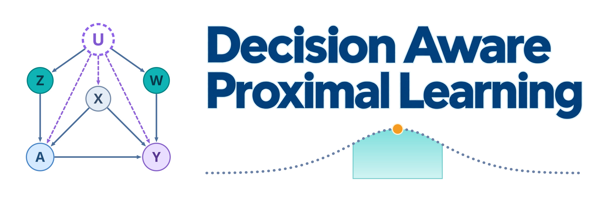

# Decision-Aware Proximal Bridge Learning for Optimal Treatment Selection

Code for **Decision-Aware Proximal Bridge Learning for Optimal Treatment Selection** by Tomàs Garriga, Alejandro Almodóvar, Axel Brando, Gerard Sanz, Eduard Serrahima de Cambra, and Juan Parras. The repository implements proximal bridge learners and decision-aware variants for continuous treatment selection under unobserved confounding.

The experiments compare PMMR, KPV, DFPV, NMMR-U and NMMR-V with their decision-aware variants, doubly robust proximal estimators and S-learner baselines. The benchmarks are synthetic and semi-synthetic proximal data-generating processes.

## Installation

The experiments use Python 3.11. Create an environment and install the main dependencies:

```bash
conda create -n decisionawarepl python=3.11
conda activate decisionawarepl
cd DecisionAwarePL
python -m pip install -r requirements.txt
```

Run all commands below from `DecisionAwarePL/`. The experiments use CPU; `--jobs` controls parallel execution. Check the installation with `python -m pytest -q`. Some integration tests train several models and can take longer than the unit tests.

Register the environment with Jupyter if needed:

```bash
python -m ipykernel install --user --name decisionawarepl --display-name "Python (DecisionAwarePL)"
jupyter lab
```

### TCGA data

The semi-synthetic benchmark uses TCGA gene-expression data. Download the dataset from the link in the [SCIGAN repository](https://github.com/ioanabica/SCIGAN) and place the pickle at `DecisionAwarePL/datasets/tcga.p`. Create `datasets/` if needed. The preprocessing code builds the feature table on first use. Data and generated files in `datasets/` are ignored by Git. Synthetic experiments do not require TCGA.

## Reproducing the experiments

The experiment and model settings are in `configs/results/`. The scripts create output directories as needed. Each command writes metrics and curves for the analysis notebooks, which also contain saved outputs.

Full experiments train multiple models over several seeds and may take substantial CPU time. Set `--jobs` to the available number of workers. For an installation check, `run_synthetic_results.py` accepts `--smoke`; smoke settings are intended for a short test.

### Hyperparameter search

The result configurations already contain model settings, so you can run the experiments below directly. To repeat or adapt hyperparameter selection, use the search configurations in `configs/hparam_search/`. Base learners are tuned with factual validation RMSE. For example, to search synthetic PMMR:

```bash
python scripts/search_hparams.py \
  --search-config configs/hparam_search/wu2024_nonadditive_pmmr.json \
  --models pmmr --jobs 1 --seed 10
```

The search writes an Optuna study, trial metrics and a `bundle_best_configs.json` under `search_results/`. Use `--max-trials` for a smaller exploratory search. Configuration files also cover the other solvers, semi-synthetic data and weighting parameters. Notebook `03_hpo_metrics_viewer.ipynb` reads trial metrics; update its `metrics_csv` path to select a study.

For each weighted learner, the training loop selects a round using factual RMSE on the validation set.

### Figure and table guide

| Paper item | Experiment | Notebook in `notebooks/` |
| --- | --- | --- |
| Figure 2 | Synthetic results | `04_synthetic_results_analysis.ipynb` |
| Figure 3 | Synthetic and semi-synthetic results | `07_doubly_robust_results.ipynb`, `07_02_semisynthetic_doubly_robust_results.ipynb` |
| Figure 4 | Synthetic and semi-synthetic results | `07_doubly_robust_results.ipynb`, `07_02_semisynthetic_doubly_robust_results.ipynb` |
| Figure 5 | Weighting ablation | `05_weight_ablation_analysis.ipynb` |
| Figure 6 | Confounding ablation | `06_confounding_ablation_analysis.ipynb` |
| Figures 8 and 10 | Synthetic and TCGA data diagnostics | `00_dataset_diagnostics.ipynb` |
| Table 3 and Figure 11 | Synthetic and semi-synthetic results | `04_synthetic_results_analysis.ipynb`, `04_02_semisynthetic_results_analysis.ipynb` |
| Tables 4–5 and Figure 12 | Completeness sensitivity and diagnostics | `10_02_sensitivity_completeness_analysis.ipynb` |
| Tables 6–7 and Figure 13 | Synthetic results with local weighting | `08_local_weighting_synthetic_results.ipynb` |
| Appendix J | Hyperparameter search | `03_hpo_metrics_viewer.ipynb` |

Figures 1, 7 and 9 are diagrams of the framework or data-generating graphs. Notebook `01_dataset_diagnostics.ipynb` contains additional dataset diagnostics. Notebook `09_sensitivity_proxy_dependence_analysis.ipynb` analyses an additional proxy-dependence sensitivity experiment.

### Main synthetic and semi-synthetic results

Run the synthetic benchmark:

```bash
python scripts/run_synthetic_results.py \
  --config configs/results/default_synthetic_results.json \
  --models pmmr,local_pmmr,weighted_pmmr,kpv,local_kpv,weighted_kpv,dfpv,local_dfpv,weighted_dfpv,nmmr_u,weighted_nmmr_u,nmmr_v,weighted_nmmr_v,dr_kpv,dr_pmmr_conditional,s_learner,naive_oosr \
  --n-seeds 10 --seed-start 1 --jobs 1 \
  --surface-patients 50 --treatment-grid-size 51 \
  --output-dir results/wu2024_article
```

Run the semi-synthetic benchmark after placing `tcga.p` in `datasets/`:

```bash
python scripts/run_synthetic_results.py \
  --config configs/results/default_semisynthetic_results.json \
  --models pmmr,weighted_pmmr,kpv,weighted_kpv,dfpv,weighted_dfpv,nmmr_u,weighted_nmmr_u,nmmr_v,weighted_nmmr_v,dr_kpv,dr_pmmr_conditional,s_learner,naive_oosr \
  --n-seeds 10 --seed-start 1 --jobs 1 \
  --surface-patients 50 --treatment-grid-size 51 \
  --output-dir results/semisynthetic_article
```

Each run writes `results_metrics.csv` and per-seed files under `runs/`, including patient and global curves. The synthetic command includes `local_*` models for the local-weighting analysis. Notebooks select their methods and metrics from the generated tables.

### Weighting and confounding ablations

```bash
python scripts/run_ablation_weights.py \
  --config configs/results/default_synthetic_results.json \
  --models weighted_pmmr,weighted_kpv,weighted_dfpv \
  --tau-grid 0.1 0.5 1.3 2.0 \
  --lam-grid 0.1 0.35 1.0 3.0 10.0 \
  --n-rounds-grid 1 2 3 5 \
  --n-seeds 5 --seed-start 1 --jobs 1 \
  --surface-patients 50 --treatment-grid-size 51 \
  --output-dir results/ablation_weights_wu2024
```

```bash
python scripts/run_ablation_confounding.py \
  --config configs/results/default_synthetic_results.json \
  --models pmmr,weighted_pmmr,kpv,weighted_kpv,dfpv,weighted_dfpv,s_learner \
  --confounding-strength-grid 0 0.1 0.5 1 2 5 \
  --n-seeds 5 --seed-start 1 --jobs 1 \
  --surface-patients 50 --treatment-grid-size 51 \
  --output-dir results/ablation_confounding_wu2024
```

Open notebooks `05` and `06`, respectively. Both read `ablation_metrics.csv` from their configured results directory.

### Sensitivity to weakened completeness

Generate the model results and latent diagnostics read by notebook `10_02`:

```bash
python scripts/run_sensitivity_completeness_10_02.py \
  --config configs/results/default_synthetic_results.json \
  --models pmmr,weighted_pmmr,kpv,weighted_kpv,dfpv,weighted_dfpv \
  --violation-grid 0 0.25 0.5 0.75 0.9 \
  --n-seeds 5 --seed-start 1 --jobs 1 \
  --surface-patients 50 --treatment-grid-size 51 \
  --output-dir results/sensitivity_completeness_10_02

python scripts/diagnose_completeness_10_02.py \
  --config configs/results/default_synthetic_results.json \
  --violation-grid 0 0.25 0.5 0.75 0.9 \
  --n-seeds 5 --seed-start 1 \
  --output-dir results/completeness_10_02_diagnostics
```


## Further experiments

Run a single experiment and select the models, dataset and training options:

```bash
python scripts/run_synthetic.py --models pmmr,weighted_pmmr --seed 10 --output-dir outputs/example
```

To use the configurations in a search bundle:

```bash
python scripts/run_synthetic.py --best_model \
  --best-config-path search_results/STUDY_GROUP/bundle_best_configs.json \
  --models pmmr --output-dir outputs/best_pmmr
```

Use `python scripts/run_synthetic.py --help` for model and dataset options, and `--help` on each experiment script for its complete arguments. The primary model implementations are in `src/models/`, weighting is in `src/weighting/`, and benchmark generators are in `src/data/`. The experiment pipeline expects the interfaces supplied by these simulators; applying it to new observational data requires a data adapter and a model-selection criterion available for that setting.

The proxy-dependence experiment is run with `scripts/run_sensitivity_proxy_dependence.py`; notebook `09_sensitivity_proxy_dependence_analysis.ipynb` reads its `results_metrics.csv`.

## Optional: DeCaFlow

DeCaFlow is available as an additional model. Follow the [original DeCaFlow installation guide](https://github.com/aalmodovares/DeCaFlow#installation) for its dependencies. The local dependency list is `requirements-decaflow.txt`. The adapter uses the modified implementation in `vendors/DeCaFlow_modified/`.

After installing its dependencies, select `decaflow` explicitly:

```bash
python scripts/run_synthetic.py --models decaflow --seed 10 --output-dir outputs/decaflow
```

DeCaFlow search configurations are available in `configs/hparam_search/`. See [THIRD_PARTY_NOTICES.md](THIRD_PARTY_NOTICES.md) for its source and license.

## Repository layout

```text
DecisionAwarePL/
  configs/        Experiment and hyperparameter-search configurations
  datasets/       Local TCGA data and generated feature cache
  notebooks/      Dataset diagnostics and result analyses
  scripts/        Experiment, ablation, sensitivity and search entry points
  src/            Models, simulators, weighting, evaluation and analysis
  tests/          Automated checks
  vendors/        Selected third-party source files and licenses
  results/        Generated experiment results
  outputs/        Generated individual-run outputs
  search_results/ Generated hyperparameter-search results
```

Data and output directories are ignored by Git. Original sources and licenses are listed in [THIRD_PARTY_NOTICES.md](THIRD_PARTY_NOTICES.md).

## Citation

When using this code, please cite:

```bibtex
@inproceedings{garriga2026decision,
 author = {Garriga, Tom{\`a}s and Almod{\'o}var, Alejandro and Brando, Axel and Sanz, Gerard and de Cambra, Eduard Serrahima and Parras, Juan},
 booktitle = {Advances in Neural Information Processing Systems},
 editor = {D. Belgrave and C. Zhang and H. Lin and R. Pascanu and P. Koniusz and M. Ghassemi and N. Chen},
 publisher = {Curran Associates, Inc.},
 title = {Decision-Aware Proximal Bridge Learning for Optimal Treatment Selection},
 volume = {39, Main Conference},
 year = {2026}
}
```

Third-party references are listed in [THIRD_PARTY_NOTICES.md](THIRD_PARTY_NOTICES.md).
